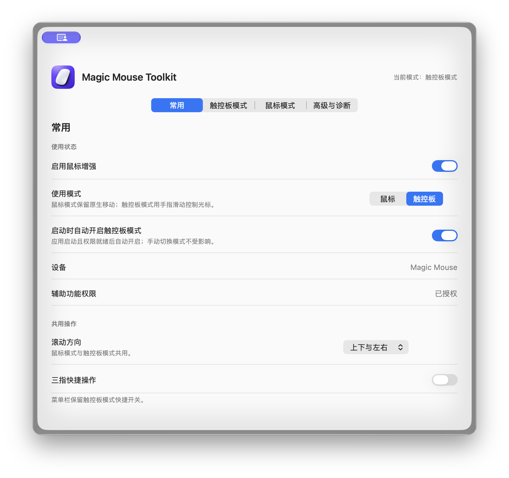
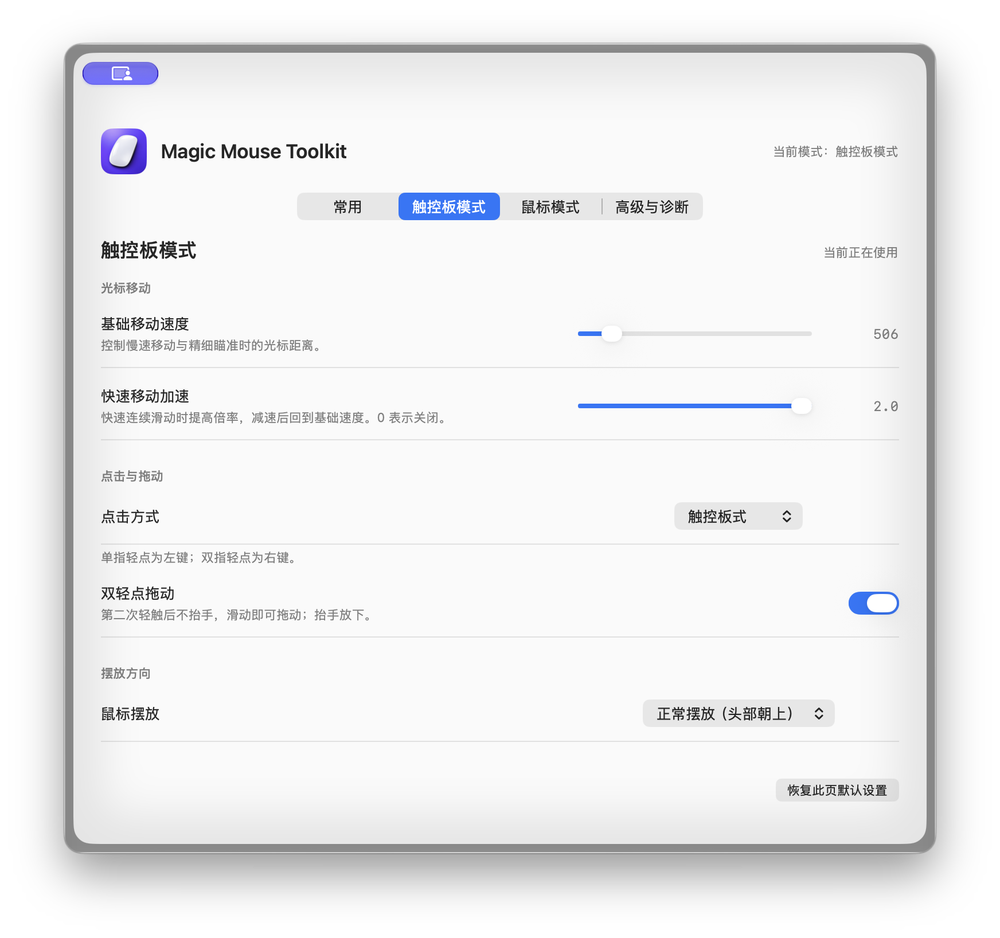
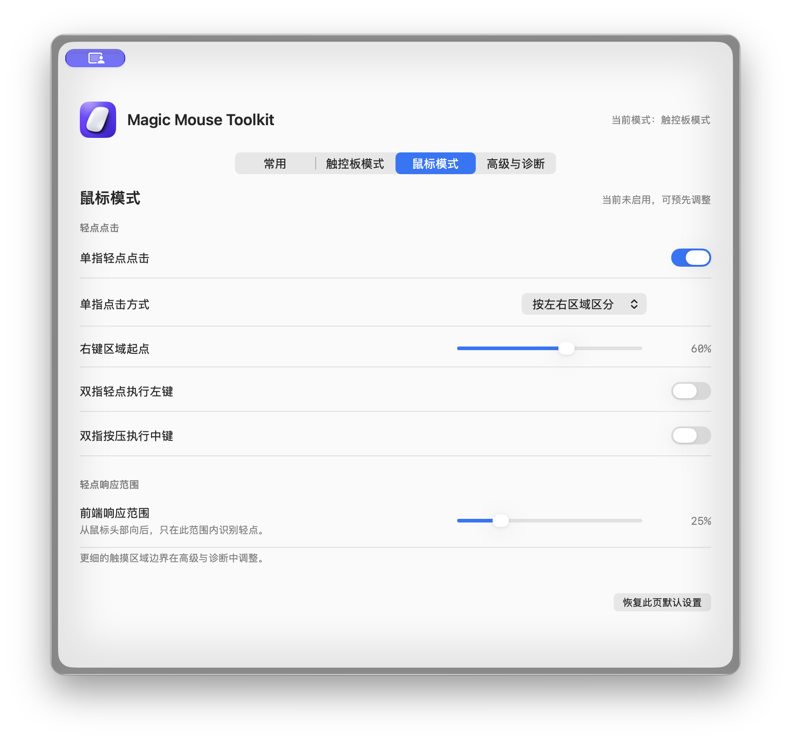
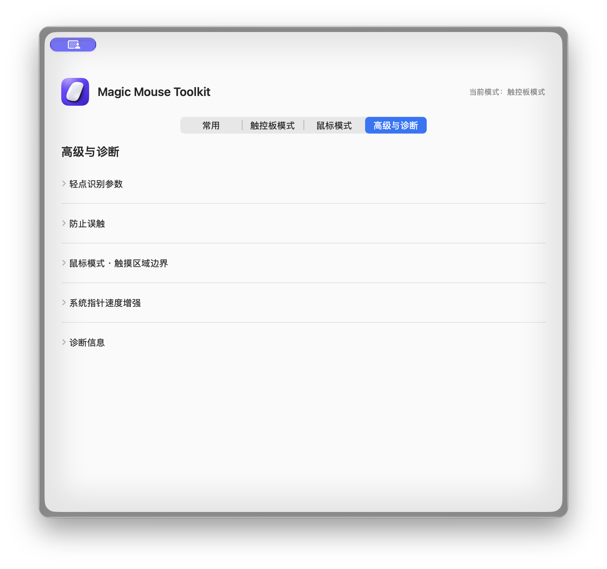

[English](#english) | [简体中文](#简体中文)

<a id="english"></a>

# Magic Mouse Toolkit (Personal Edition)

<p align="center">
  
</p>

This macOS utility is based on [mori0818/Magic Mouse Toolkit](https://github.com/mori0818/magic-mouse-toolkit). This repository documents my personal edition, which explores using Apple Magic Mouse as a trackpad-like input surface for controlling a Mac.

This project builds on and extends the original code while preserving its attribution, license, and third-party notices. It is not an official release by the original author. My changes are on the [`drfcy-custom-edition` branch](https://github.com/drfcy/magic-mouse-toolkit/tree/drfcy-custom-edition).

## Download and installation

**[Download Magic Mouse Toolkit Personal v1.0.0 (macOS)](https://github.com/drfcy/magic-mouse-toolkit/releases/download/v1.0.0/Magic-Mouse-Toolkit-Personal-v1.0.0-macOS.zip)** · [Release notes](https://github.com/drfcy/magic-mouse-toolkit/releases/tag/v1.0.0)

- Requirements: macOS 26 or later, an Apple Silicon or Intel Mac, and Apple Magic Mouse.
- Download and extract the ZIP, drag `Magic Mouse Toolkit.app` into Applications, and open it.
- The app needs Accessibility permission for click synthesis and input processing. Follow the system prompts on first use.
- This release is ad-hoc signed. It is not signed with an Apple Developer ID or notarized. macOS may warn that the developer cannot be verified. First confirm that the file came from this repository's Release, then follow the prompts in Privacy & Security to allow it to open.

## Interface preview

These screenshots show the app built from this branch. The screenshots use the Simplified Chinese interface; English and Japanese interfaces are also available.

<p align="center">
  
  
</p>
<p align="center"><sub>General (left) · Trackpad mode (right)</sub></p>

<p align="center">
  
  
</p>
<p align="center"><sub>Mouse mode (left) · Advanced and diagnostics (right)</sub></p>

## Why I made this edition

Magic Mouse has a multitouch surface that recognizes taps, swipes, and gestures involving multiple fingers. In my own use, its main difficulty as a conventional mouse has been precise pointing: changes in where my fingers contact the surface can affect the cursor, and even small changes can make it difficult to hit a small target accurately. Compared with conventional mice I have used, such as the Logitech GPW3 (Logitech G Pro X Superlight 2), I see Magic Mouse's strength in its touch surface and multifinger input rather than in replacing the pointing precision of a conventional mouse.

This edition therefore explores a different use: **treating Magic Mouse as a trackpad-like touch surface.** Trackpad mode converts finger movement on the mouse surface into cursor movement, with settings for taps, click style, scroll direction, and sensitivity. Cursor gain and acceleration can also be adjusted to improve the feel of slow positioning and fast movement.

### Full comparison of the two mice's measured specifications

The table below compiles data from the RTINGS test screenshots I supplied. GPW3 refers here to the Logitech G Pro X Superlight 2.

| Test metric | Apple Magic Mouse 2 | Logitech GPW3 (G Pro X Superlight 2) |
| --- | ---: | ---: |
| CPI score | 6.0 | **9.8** |
| SRAV (speed-related accuracy variation) | +1.00% | **−0.04% (1600 CPI)** |
| Precision error between speeds | 3.85% | **0.34%** |
| Worst tracking error | −27.15% | **1.44%** |
| CPI range | Fixed at 1300 | Adjustable, minimum 100 |
| CPI adjustment increment | Not supported | 1 CPI |
| Sensor latency score | 6.2 | **9.4** |
| Mid-movement latency | 23.7 ms | **1.4 ms** |
| Click latency score | 3.4 | **9.8** |
| Wireless click latency | 44.4 ms (Bluetooth) | **1.5 ms (receiver)** |
| Maximum wireless polling rate | Approximately 90 Hz (other tests) | **8000 Hz** |
| Weight | Approximately 99 g | **Approximately 60 g** |
| Connection | Bluetooth | LIGHTSPEED wireless receiver |

Sources: [RTINGS Apple Magic Mouse 2 review](https://www.rtings.com/mouse/reviews/apple/magic-mouse-2?share_token=ZHQVeCAFp2EUqG71TACcUUSY-3oh335x); [RTINGS Logitech G Pro X Superlight 2 review](https://www.rtings.com/mouse/reviews/logitech/g-pro-x-superlight-2?share_token=jtg4JUMtqqbIA9gwXpGg-OLOhg6f5HtA). GPW3's 8000 Hz is its supported maximum polling rate; actual rates depend on device settings, receiver, and system environment. The approximately 90 Hz figure for Magic Mouse 2 comes from other tests and is not a fixed value applicable to every environment.

The SRAV test settings differ: Magic Mouse 2 was tested at its fixed 1300 CPI, while the corresponding GPW3 result was measured at 1600 CPI. These figures help describe each mouse's consistency across speeds, but are not a laboratory comparison under identical settings. RTINGS results also do not directly represent the final cursor experience on macOS.

### How these figures relate to imprecise pointing

- **Movement feedback latency differs substantially.** Mid-movement latency is 23.7 ms for Magic Mouse 2 versus 1.4 ms for GPW3, approximately 17 times as high. This may make deceleration and fine adjustments near small targets feel less responsive.
- **Tracking consistency across speeds differs.** Precision error between speeds is 3.85% for Magic Mouse 2 and 0.34% for GPW3, a numerical ratio of approximately 11.3. This describes consistency as speed changes; it does not mean that GPW3's practical pointing accuracy is 11.3 times better.
- **Click feedback also differs substantially.** Wireless click latency is 44.4 ms versus 1.5 ms, a numerical ratio of approximately 30. This mainly affects response time. If the cursor has already stopped, this latency alone would not normally move the click to another position.
- **Average tracking deviation and the worst result should be distinguished.** Magic Mouse 2's average tracking deviation is approximately −20%, with a relatively flat curve. A consistent proportional deviation can be compensated for by adjusting tracking speed. The −27.15% figure is the worst test result, not a typical error for every everyday movement. GPW3's worst tracking error is 1.44%, with a curve close to the 0% error line.

These measurements show clear advantages for GPW3 in tracking consistency, movement response, and click response, which supports my motivation to repurpose Magic Mouse for trackpad-like input. However, imprecise pointing may also involve changes in finger contact area, macOS pointer acceleration, and movement of the mouse during a physical press. These RTINGS tests do not directly measure my complete interaction sequence, so the data describe hardware differences rather than prove a single cause.

Two practical considerations also motivated this approach:

- **Control a Mac without a desk.** Holding Magic Mouse in one hand allows cursor movement and taps, so it can serve as a simple handheld remote input device when sitting farther away from the Mac.
- **Try trackpad-like input at a lower cost.** In my purchasing situation, Magic Mouse cost considerably less than Magic Trackpad. If you already have Magic Mouse, this approach also lets you experiment using existing hardware.

These figures come from particular tests and materials I supplied. They do not replace comparisons under each user's own desk setup, system settings, and grip. The design motivation remains my personal judgment, not a claim about every user's experience or a claim that the software fully reproduces Apple Magic Trackpad's hardware, system behavior, or complete gesture set.

## My setup

The software is only one part of the setup. My intended workflow and actual configuration combine this app, BetterTouchTool (BTT), and my personal hardware arrangement:

1. Enable Trackpad mode in this app to move the cursor by sliding a finger on Magic Mouse, and configure tapping and click style as needed.
2. In BetterTouchTool, assign actions to Magic Mouse gestures such as two-finger zoom, three-finger left/right switching, and three-finger swipe up. Which gestures are recognized depends on the BTT configuration and input events currently available from macOS.
3. To reduce sliding on a desk, I attach anti-slip pads to the bottom of the mouse. I also cover its optical sensor to prevent that sensor from continuing to move the cursor. These are personal hardware modifications, not software features or required steps for every user.

This app mainly handles Magic Mouse touch input, cursor movement, taps, and related scrolling. BetterTouchTool handles user-configured system gestures and shortcuts. Conventional mice and trackpads can still be used in their usual ways. Some orientation-dependent behaviors, including scrolling with the mouse placed sideways, remain experimental; the setup should not be taken to implement all Magic Trackpad gestures completely.

## Changes in this edition

- Settings are organized into General, Trackpad mode, Mouse mode, and Advanced and diagnostics.
- A Simplified Chinese interface has been added alongside English and Japanese.
- Trackpad mode can be toggled directly from the menu bar and optionally enabled at launch.
- Choose between trackpad-style taps (one finger for left click, two fingers for right click) and left/right click zones.
- Cursor acceleration has been added, with separate adjustments for the base gain during slow movement and acceleration during fast movement.
- Cursor direction and movement scaling can be adjusted when the mouse is placed sideways.
- Settings cover tap recognition, scrolling, device detection, and diagnostics.

This list describes settings and implementations present in this branch. It does not mean that the app itself implements BetterTouchTool's gestures or that every combination of orientation and device setup has been fully verified.

## App icon

The icon features a white Magic Mouse on a purple rounded background. The white mouse identifies the target device, while the rounded icon and purple background distinguish this personal edition. It represents the project's focus on touch input using the mouse surface; the icon itself does not imply any functionality.

## Requirements

- macOS 26 or later
- Apple Magic Mouse
- Xcode or a Swift toolchain containing the macOS 26 SDK to build
- Accessibility permission for click synthesis, macros, and input mapping

The app uses Apple's private `MultitouchSupport.framework` and IOKit interfaces. Updates may be needed after macOS changes, and it is not suitable for Mac App Store distribution.

## Build and run

Explicitly check out the personal-edition branch. This repository's `main` branch still follows the original project's mainline.

```sh
git clone --branch drfcy-custom-edition --single-branch https://github.com/drfcy/magic-mouse-toolkit.git
cd magic-mouse-toolkit
./build.sh
open "build/Magic Mouse Toolkit.app"
```

The default is ad-hoc signing. To use your own signing identity, set `SIGN_ID`:

```sh
SIGN_ID="Developer ID Application: Your Name (TEAMID)" ./build.sh
```

Do not commit signing certificates or private keys. macOS may require permission to be granted again after a signing change. Quit the old version before changing permissions.

## Privacy

- The app itself contains no telemetry, analytics SDKs, or network transmission features.
- Macro recording stores key codes, modifier flags, key-down state, and timing intervals in local UserDefaults. It does not store or transmit the text corresponding to keystrokes. Do not record while entering passwords or other secrets.
- Diagnostic logs are stored at `~/Library/Logs/MagicMouseToolkit.log` and rotate at approximately 1 MiB. Logs may contain runtime information such as gesture decisions and coordinates.

## Before use

Do not disable or remove the app's Accessibility permission in System Settings while it is running. To change permissions, first quit normally from the menu bar, change the permission, and reopen the app. Changing permissions incorrectly may temporarily interrupt system input. See [SAFETY.md](./SAFETY.md) for details.

The system pointer-speed boost temporarily changes the global `HIDMouseAcceleration` and restores it on normal exit. If speed is not restored after a force quit, first quit the app, then move the Tracking speed slider once in System Settings → Mouse.

## Attribution and license

This project is a modified derivative of [mori0818/Magic Mouse Toolkit](https://github.com/mori0818/magic-mouse-toolkit). The original project also documents third-party projects it drew on and their licenses. Preserve [THIRD_PARTY_NOTICES.md](./THIRD_PARTY_NOTICES.md), [LICENSE](./LICENSE), and the relevant copyright notices.

This project is distributed under GNU GPL v3.0 only. See [THIRD_PARTY_NOTICES.md](./THIRD_PARTY_NOTICES.md) for third-party code provenance and licensing.

## Other documentation

- [SAFETY.md](./SAFETY.md): permission changes, input issues, and system mouse speed
- [SPEC.md](./SPEC.md): functional specification
- [ARCHITECTURE.md](./ARCHITECTURE.md): architecture and code provenance
- [IMPLEMENTATION.md](./IMPLEMENTATION.md): implementation details
- [DESIGN.md](./DESIGN.md): design system and UI tokens
- [UI_DESIGN.md](./UI_DESIGN.md): UI design considerations
- [docs/LOCALIZATION_PLAN.md](./docs/LOCALIZATION_PLAN.md): historical localization implementation plan
- [THIRD_PARTY_NOTICES.md](./THIRD_PARTY_NOTICES.md): third-party code and licenses
- [CONTRIBUTING.md](./CONTRIBUTING.md): contribution guidelines
- [SECURITY.md](./SECURITY.md): reporting security issues
- [prototypes/README.md](./prototypes/README.md): prototype experiments

---

<a id="简体中文"></a>

# Magic Mouse Toolkit（个人修改版）

<p align="center">
  
</p>

这是基于 [mori0818/Magic Mouse Toolkit](https://github.com/mori0818/magic-mouse-toolkit) 修改的 macOS 工具。本仓库记录的是个人修改版，主要尝试把 Apple Magic Mouse 从传统鼠标改造成一种可以像触控板一样操作 Mac 的输入设备。

本项目沿用并扩展了原项目的代码，保留其来源、许可证和第三方代码说明；它不是原作者发布的官方版本。个人修改目前位于 [`drfcy-custom-edition` 分支](https://github.com/drfcy/magic-mouse-toolkit/tree/drfcy-custom-edition)。

## 下载与安装

**[下载 Magic Mouse Toolkit Personal v1.0.0（macOS）](https://github.com/drfcy/magic-mouse-toolkit/releases/download/v1.0.0/Magic-Mouse-Toolkit-Personal-v1.0.0-macOS.zip)** · [查看版本说明](https://github.com/drfcy/magic-mouse-toolkit/releases/tag/v1.0.0)

- 要求：macOS 26 或更高版本；支持 Apple 芯片和 Intel Mac；需要 Apple Magic Mouse。
- 下载并解压 ZIP，将 `Magic Mouse Toolkit.app` 拖入“应用程序”文件夹后打开。
- 应用需要“辅助功能”权限才能执行点击模拟和输入处理；首次使用时按系统提示授权。
- 当前版本使用 ad-hoc 签名，未经 Apple Developer ID 签名和公证。macOS 可能提示无法验证开发者；请先确认文件来自本仓库的 Release，再按系统的“隐私与安全性”提示允许打开。

## 界面预览

以下截图来自本分支构建的应用：

<p align="center">
  
  
</p>
<p align="center"><sub>常用设置（左） · 触控板模式（右）</sub></p>

<p align="center">
  
  
</p>
<p align="center"><sub>鼠标模式（左） · 高级与诊断（右）</sub></p>

## 为什么做这个修改版

Magic Mouse 有多点触控表面，能识别轻点、滑动和多指手势。但在我的实际使用中，它作为传统鼠标时最突出的困难是光标点选不够准确：光标会受手指在表面的接触位置影响，小幅变化也可能让指针偏移，精确点中小目标并不容易。与我使用过的罗技 GPW3（Logitech G Pro X Superlight 2）等传统鼠标相比，我认为 Magic Mouse 的优势不在于取代常规鼠标的定位精度，而在于它的触控表面和多指输入能力。

因此，这个修改版想探索另一种用法：**不把 Magic Mouse 当作一只普通鼠标来用，而是把它当作妙控板式的触控输入面。** 软件中的“触控板模式”把手指在鼠标表面的移动转换为光标移动，并提供轻点、点击方式、滚动方向和灵敏度等设置。光标移动倍率和加速度也可以调整，以改善慢速定位和快速移动时的手感。

### 两款鼠标的实测参数完整对比

下表整理了我提供的 RTINGS 测试截图中的数据。GPW3 在这里指 Logitech G Pro X Superlight 2。

| 测试指标 | Apple Magic Mouse 2 | Logitech GPW3（G Pro X Superlight 2） |
| --- | ---: | ---: |
| CPI 综合评分 | 6.0 | **9.8** |
| SRAV（速度相关误差变化） | +1.00% | **−0.04%（1600 CPI）** |
| 速度间精度误差 | 3.85% | **0.34%** |
| 最差追踪误差 | −27.15% | **1.44%** |
| CPI 范围 | 固定 1300 | 可调，最低 100 |
| CPI 调节步长 | 不支持 | 1 CPI |
| 传感器延迟评分 | 6.2 | **9.4** |
| 移动中途延迟 | 23.7 ms | **1.4 ms** |
| 点击延迟评分 | 3.4 | **9.8** |
| 无线点击延迟 | 44.4 ms（蓝牙） | **1.5 ms（接收器）** |
| 无线最大回报率 | 约 90 Hz（其他测试） | **8000 Hz** |
| 重量 | 约 99 g | **约 60 g** |
| 连接方式 | 蓝牙 | LIGHTSPEED 无线接收器 |

参数来源：[RTINGS Apple Magic Mouse 2 测试](https://www.rtings.com/mouse/reviews/apple/magic-mouse-2?share_token=ZHQVeCAFp2EUqG71TACcUUSY-3oh335x)；[RTINGS Logitech G Pro X Superlight 2 测试](https://www.rtings.com/mouse/reviews/logitech/g-pro-x-superlight-2?share_token=jtg4JUMtqqbIA9gwXpGg-OLOhg6f5HtA)。GPW3 的 8000 Hz 是支持的最高回报率，实际回报率还取决于设备设置、接收器和系统环境；Magic Mouse 2 的约 90 Hz 来自其他测试，并非固定适用于所有环境。

两款鼠标的 SRAV 测试设置并不相同：Magic Mouse 2 在固定 1300 CPI 下测试，GPW3 的对应数据是在 1600 CPI 下测试。因此这些数据适合说明各自的速度稳定性，但不是完全同设置的实验室对照。RTINGS 的测试也不能直接等同于 macOS 上最终的光标体验。

### 这些数据如何解释“点不准”

- **移动反馈延迟差距明显。** Magic Mouse 2 的移动中途延迟为 23.7 ms，GPW3 为 1.4 ms，前者约为后者的 17 倍。这可能让小目标附近的减速和微调显得不够跟手。
- **不同速度下的追踪一致性有差距。** Magic Mouse 2 的速度间精度误差为 3.85%，GPW3 为 0.34%，数值约相差 11.3 倍。它反映的是速度变化时追踪结果的一致性差距，不能说 GPW3 的实际定位精度因此提高了 11.3 倍。
- **点击反馈也有明显差距。** 无线点击延迟分别为 44.4 ms 和 1.5 ms，数值约相差 30 倍。它主要影响点击响应快慢；如果光标已经停稳，这项延迟本身通常不会把点击位置移到别处。
- **总体追踪误差和最差值要分开理解。** Magic Mouse 2 的平均追踪偏差约为 −20%，曲线整体较平，固定比例偏差可以通过调整跟踪速度补偿；−27.15% 是最差测试值，不是日常每次移动的典型误差。GPW3 的最差追踪误差为 1.44%，曲线接近 0% 误差线。

从这组实测数据看，GPW3 在追踪一致性、移动响应和点击响应方面有明显优势，这支持了我把 Magic Mouse 改作触控板式输入设备的动机。但“点不准”还可能同时受到手指接触面积变化、macOS 指针加速、按压时鼠标是否移动等因素影响；这些 RTINGS 测试没有直接测量我个人的完整操作链路，所以数据解释的是硬件差异，不是对单一原因的证明。

这个思路还有两点实际考虑：

- **不用桌面也能操作 Mac。** 把 Magic Mouse 拿在手里，可以单手移动光标和执行轻点；人在离 Mac 较远的地方时，也能把它当作简单的手持遥控输入设备。
- **提供一种成本较低的尝试。** 在我的购买场景中，Magic Mouse 的价格明显低于妙控板。若手边已经有 Magic Mouse，这种方案也可以利用现有设备探索触控板式操作。

这些参数来自特定测试和我提供的资料，不能替代每位用户在自己的桌面、系统设置和握持方式下进行的对照测试。设计动机仍是个人使用判断，不代表所有用户的体验，也不声称软件可以完全复制 Apple 妙控板的硬件、系统行为或全部手势。

## 我的使用方案

软件只是整个方案的一部分。我的设想和实际配置由软件、BetterTouchTool（BTT）以及个人的硬件摆放方式共同组成：

1. 在本软件中开启“触控板模式”，用手指在 Magic Mouse 表面滑动来移动光标，并按需要设置轻点与点击方式。
2. 对双指缩放、三指左右切换、三指上滑等组合手势，在 BetterTouchTool 中为 Magic Mouse 设置对应操作。具体能识别哪些手势，取决于 BTT 的配置和 macOS 当前提供的输入事件。
3. 为了在桌面上使用时减少设备滑动，我会在鼠标底部贴防滑胶贴；为了避免底部光学传感器继续带动指针，我会遮住该传感器。这是我的个人硬件改造方式，不属于软件功能，也不是所有用户都必须照做。

本软件主要负责 Magic Mouse 的触摸输入、光标移动、轻点和相关滚动处理；BetterTouchTool 负责由用户配置的系统手势与快捷操作。普通鼠标和妙控板仍可按各自的方式使用。横置滚动等部分方向相关行为仍在探索中，不能据此认为所有妙控板手势都已完整实现。

## 这个版本改了什么

- 设置界面整理为“常用”“触控板模式”“鼠标模式”“高级与诊断”四个类别。
- 新增简体中文界面，并保留英文和日文。
- 可从菜单栏直接开关触控板模式，也可设置应用启动后自动开启。
- 可选触控板式轻点（单指左键、双指右键）或左右分区式点击。
- 增加光标加速度，并可分别调整慢速移动的基础倍率与快速移动的加速。
- 支持鼠标横向摆放时调整光标移动方向和轨迹比例。
- 提供轻点识别、滚动、设备检测和诊断等设置。

此列表描述本分支中已有的设置与实现，不表示本软件单独实现了 BetterTouchTool 的手势，也不表示所有方向组合和设备场景都经过了完整验证。

## 应用图标

图标以白色 Magic Mouse 为主体，放在紫色圆角底上。白色鼠标图形直接标明软件对应的设备；圆角图标和紫色背景则用于识别这个个人修改版。它表达的是“用鼠标表面进行触控操作”的项目方向，不代表图标本身包含任何功能。

## 要求

- macOS 26 或更高版本
- Apple Magic Mouse
- 构建需要 Xcode，或包含 macOS 26 SDK 的 Swift 工具链
- 执行点击合成、宏和输入映射需要“辅助功能”权限

本程序使用 Apple 的私有 `MultitouchSupport.framework` 和 IOKit 接口，macOS 更新后可能需要调整，也不适用于 Mac App Store 发布。

## 构建和运行

请明确检出个人修改分支；仓库的 `main` 分支仍对应原项目的主线。

```sh
git clone --branch drfcy-custom-edition --single-branch https://github.com/drfcy/magic-mouse-toolkit.git
cd magic-mouse-toolkit
./build.sh
open "build/Magic Mouse Toolkit.app"
```

默认使用 ad-hoc 签名。如有自己的签名身份，可通过 `SIGN_ID` 指定：

```sh
SIGN_ID="Developer ID Application: Your Name (TEAMID)" ./build.sh
```

不要把签名证书或私钥提交到仓库。更换签名后，macOS 可能要求重新授权；请先退出旧版本，再修改权限。

## 隐私

- 程序本身不包含遥测、分析 SDK 或网络传输功能。
- 录制宏时，按键代码、修饰键、按下状态和时间间隔会保存在本机的 UserDefaults 中；不会保存或发送按键对应的文字内容。请勿在输入密码或其他秘密信息时录制。
- 诊断日志保存在 `~/Library/Logs/MagicMouseToolkit.log`，约 1 MiB 后轮换；日志可能包含手势判断、坐标等运行信息。

## 使用前请留意

程序运行时不要在系统设置中关闭或移除它的“辅助功能”权限。若要更改权限，请先从菜单栏正常退出程序，再修改权限并重新打开。权限操作不当可能导致系统输入暂时失灵。更多说明见 [SAFETY.md](./SAFETY.md)。

系统指针速度增强会暂时修改全局 `HIDMouseAcceleration`，正常退出时会恢复。如果程序被强制退出后速度没有恢复，请先退出程序，再到“系统设置 → 鼠标”移动一次“跟踪速度”滑块。

## 来源与许可证

本项目是原项目的衍生修改版本。原项目为 [mori0818/Magic Mouse Toolkit](https://github.com/mori0818/magic-mouse-toolkit)。原项目也记录了所借鉴的第三方项目及其许可。请保留仓库中的 [THIRD_PARTY_NOTICES.md](./THIRD_PARTY_NOTICES.md)、[LICENSE](./LICENSE) 和相关版权声明。

本项目按 GNU GPL v3.0 only 发布。第三方代码来源及许可说明见 [THIRD_PARTY_NOTICES.md](./THIRD_PARTY_NOTICES.md)。

## 其他文档

- [SAFETY.md](./SAFETY.md)：权限修改、输入异常与系统鼠标速度
- [SPEC.md](./SPEC.md)：功能规格
- [ARCHITECTURE.md](./ARCHITECTURE.md)：架构与代码来源
- [IMPLEMENTATION.md](./IMPLEMENTATION.md)：实现细节
- [THIRD_PARTY_NOTICES.md](./THIRD_PARTY_NOTICES.md)：第三方代码与许可证
- [CONTRIBUTING.md](./CONTRIBUTING.md)：贡献指南
- [SECURITY.md](./SECURITY.md)：安全问题反馈
- [DESIGN.md](./DESIGN.md)：设计系统与界面令牌
- [UI_DESIGN.md](./UI_DESIGN.md)：界面设计考量
- [docs/LOCALIZATION_PLAN.md](./docs/LOCALIZATION_PLAN.md)：早期本地化实施计划
- [prototypes/README.md](./prototypes/README.md)：原型验证代码
